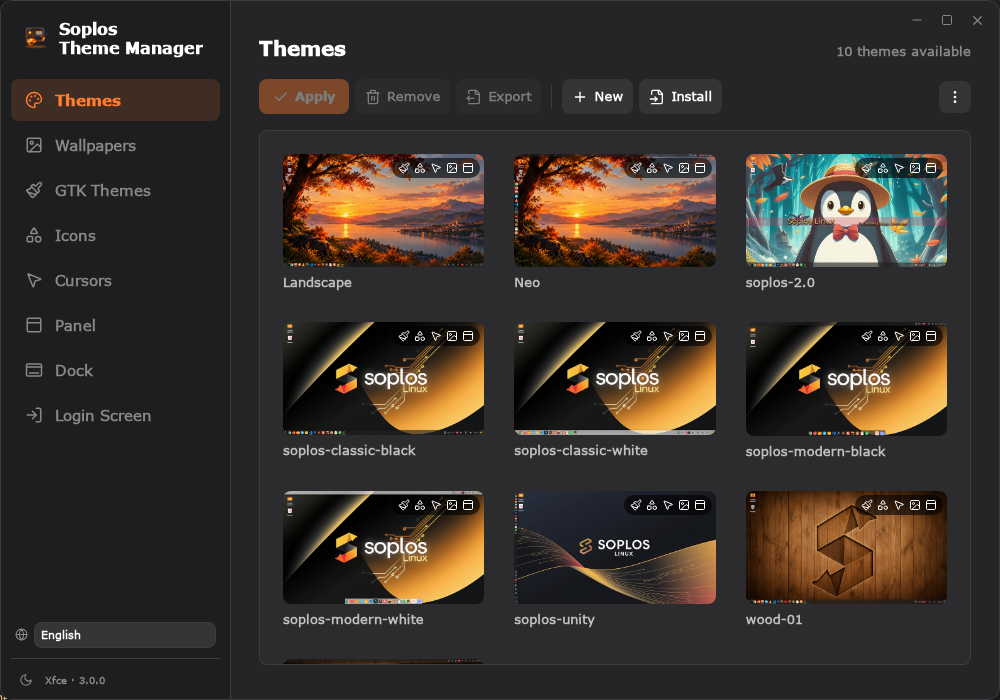
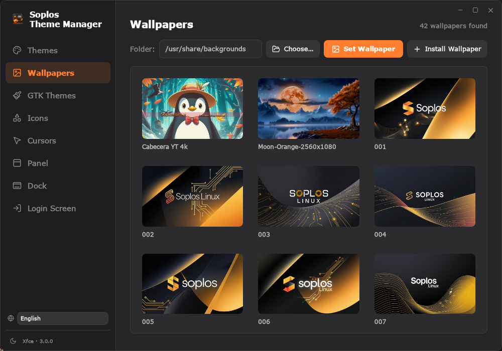
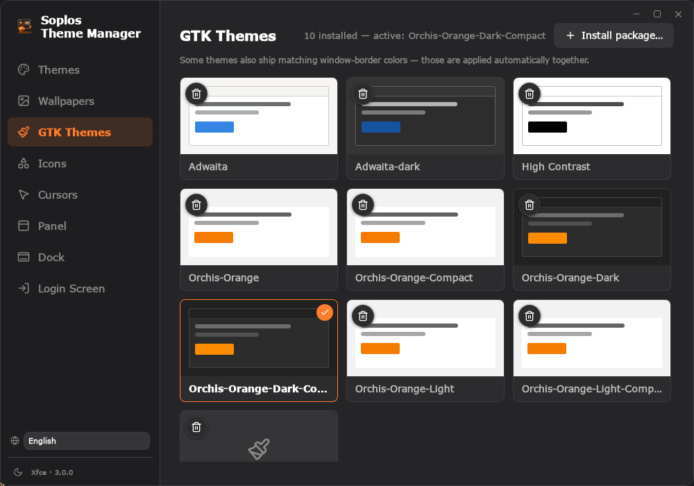
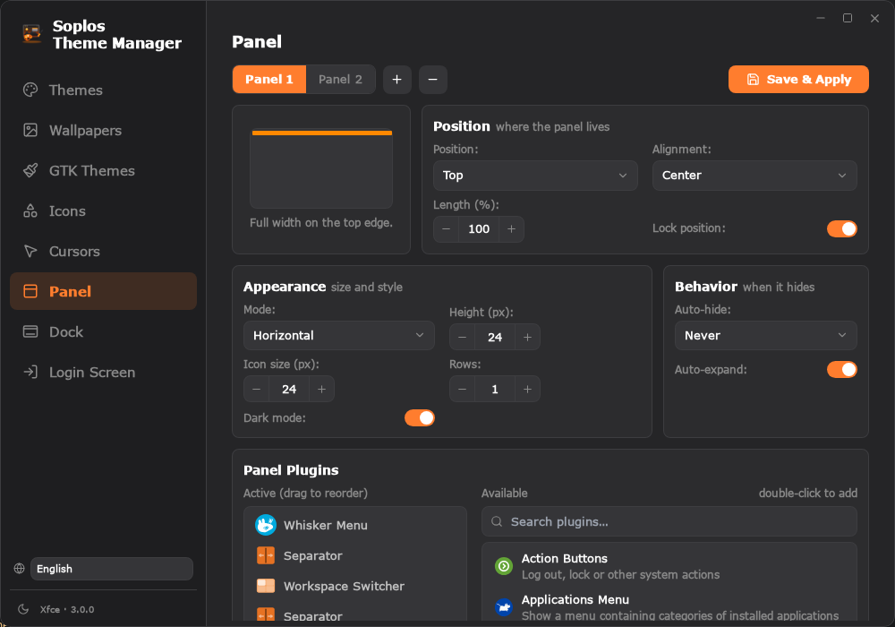
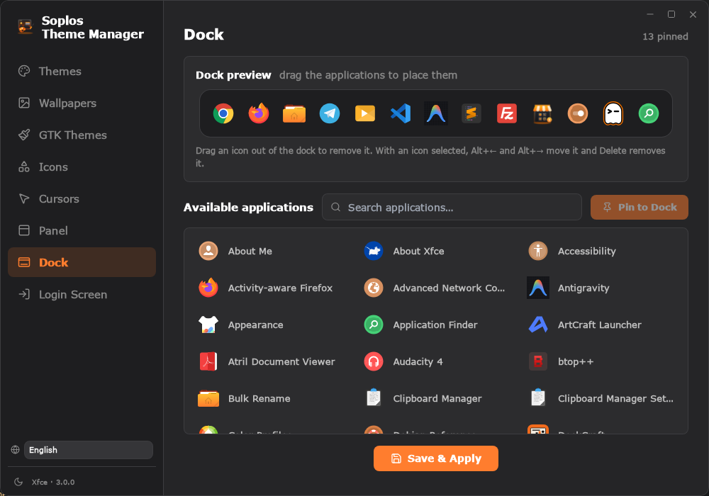
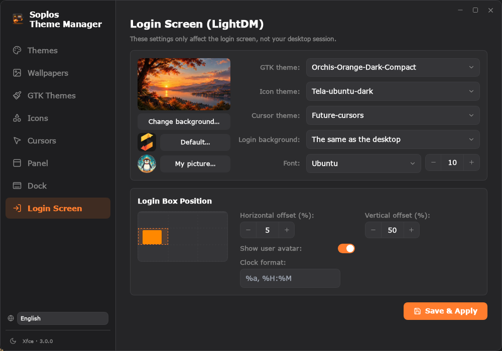
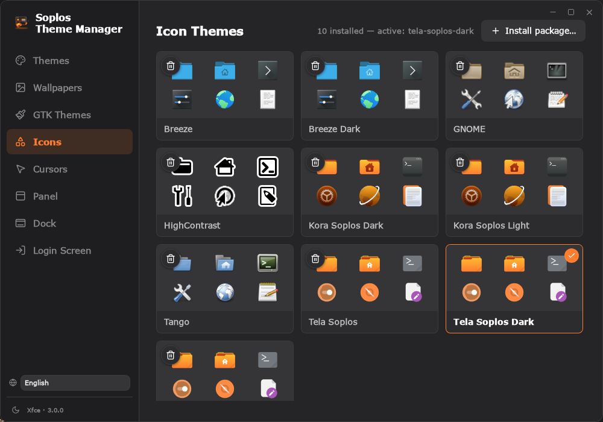
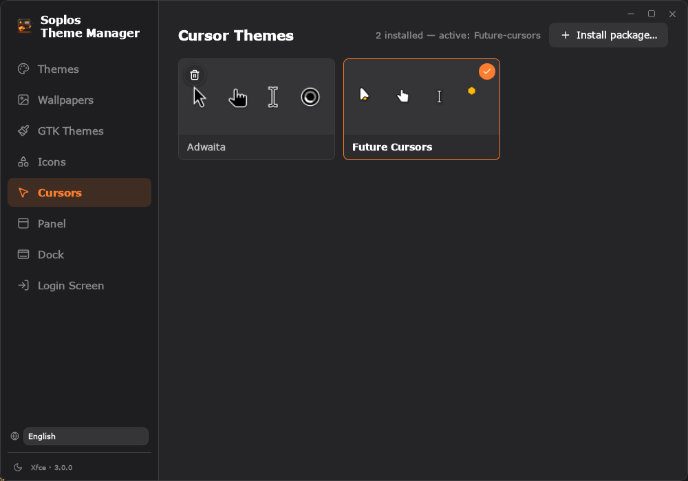

# Soplos Theme Manager 3.0


Theme manager for Soplos Linux Tyron (Xfce): themes, wallpapers, GTK themes, icons and cursors, panel, dock and login screen.

Version 3.0 is a rewrite of the 2.x program, written in Python 3 with GTK3, with Tauri 2: a Rust backend and a Svelte 4 and Tailwind CSS interface. All the pages of 2.x are ported. The pages are: Themes, Wallpapers, GTK Themes, Icons, Cursors, Panel, Dock and Login Screen.

|  The complete desktop themes you have saved, each card with small icons of what the theme carries |  The wallpapers of a folder, set as the wallpaper of every screen |
|:---:|:---:|
|  The installed GTK themes drawn with their colors, with the active one marked |  The position, appearance, behavior and plugins of the Xfce panel |
|  The dock is edited by dragging its applications into the strip |  The LightDM greeter: background, themes, font and where the login box goes |
|  The installed icon themes, each with six of its icons |  The installed cursor themes, each with four of its cursors |

## Pages

- **Themes**: apply, save, delete, export and import complete desktop themes (`.sth` files), each card with small icons of what the theme carries.
- **Wallpapers**: browse the pictures of a folder, set one as the background of every screen and workspace, and install new ones for every user.
- **GTK Themes**: the installed GTK themes as cards drawn with their colors; a click applies one, and the program installs and deletes themes. A theme that brings colors for the window borders sets them too.
- **Icons**: the installed icon themes as cards with six of their icons; a click applies one, and the program installs and deletes themes.
- **Cursors**: the installed cursor themes as cards with four of their cursors; a click applies one, and the program installs and deletes themes.
- **Panel**: the panels of Xfce, their position, appearance and behavior, and their plugins.
- **Dock**: the pinned applications of the Docklike Taskbar, edited by dragging them on the preview of the dock.
- **Login Screen**: the settings of the LightDM GTK greeter: background, themes, font, position of the login box and clock.

## Development

```bash
npm install
npm run tauri dev
```

## Packaging

```bash
./package.sh
```

## License

GPL-3.0-or-later.
